<picture><source media="(prefers-color-scheme: dark)" srcset="assets/hero-dark.svg"></picture>

<picture><source media="(prefers-color-scheme: dark)" srcset="assets/social-l-dark.svg"></picture><a href="https://t.me/octo_core"><picture><source media="(prefers-color-scheme: dark)" srcset="assets/social-1-dark.svg"></picture></a><a href="https://steamcommunity.com"><picture><source media="(prefers-color-scheme: dark)" srcset="assets/social-2-dark.svg"></picture></a><picture><source media="(prefers-color-scheme: dark)" srcset="assets/social-r-dark.svg"></picture>

<picture><source media="(prefers-color-scheme: dark)" srcset="assets/about-dark.svg"></picture>

<picture><source media="(prefers-color-scheme: dark)" srcset="assets/stack-dark.svg"></picture>

<a href="https://github.com/OctoCore-Dev/obxodka"><picture><source media="(prefers-color-scheme: dark)" srcset="assets/project-obxodka-dark.svg"></picture></a>&nbsp;<a href="https://github.com/irovbyte/Uni-Sentinel"><picture><source media="(prefers-color-scheme: dark)" srcset="assets/project-uni-sentinel-dark.svg"></picture></a>

<a href="https://github.com/irovbyte/CIDE"><picture><source media="(prefers-color-scheme: dark)" srcset="assets/project-cide-dark.svg"></picture></a>

<picture><source media="(prefers-color-scheme: dark)" srcset="assets/stats-dark.svg"></picture>

<picture><source media="(prefers-color-scheme: dark)" srcset="assets/streak-dark.svg"></picture>

<picture><source media="(prefers-color-scheme: dark)" srcset="assets/wave-dark.svg"></picture>

<a href="https://obxodka.one"><picture><source media="(prefers-color-scheme: dark)" srcset="assets/button-1-dark.svg"></picture></a>&nbsp;&nbsp;<a href="https://nuget.octopublisher.octocore.dev"><picture><source media="(prefers-color-scheme: dark)" srcset="assets/button-2-dark.svg"></picture></a>&nbsp;&nbsp;<a href="https://github.com/irovbyte?tab=repositories"><picture><source media="(prefers-color-scheme: dark)" srcset="assets/button-3-dark.svg"></picture></a>

<a href="https://metawka.github.io/expressive-profile/?from=irovbyte"><picture><source media="(prefers-color-scheme: dark)" srcset="assets/credit-dark.svg"></picture></a>

